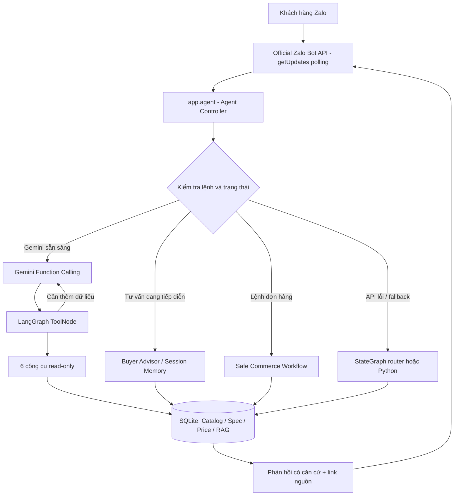
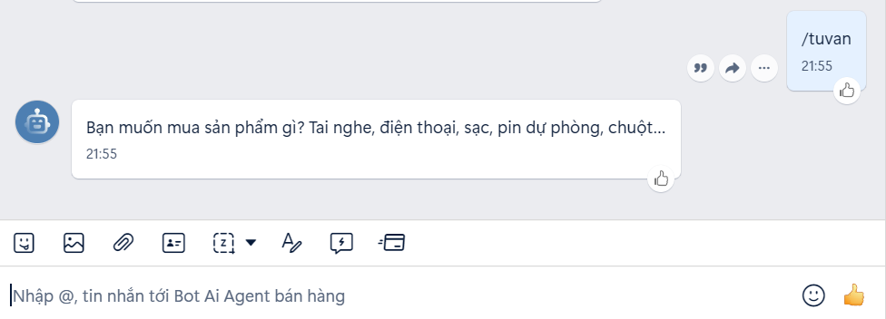
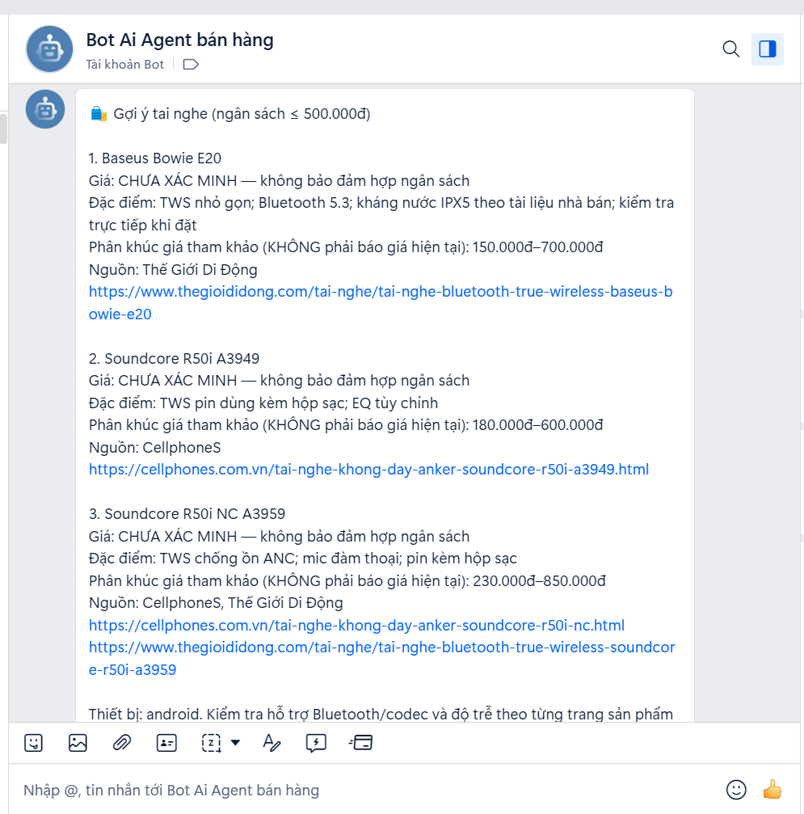
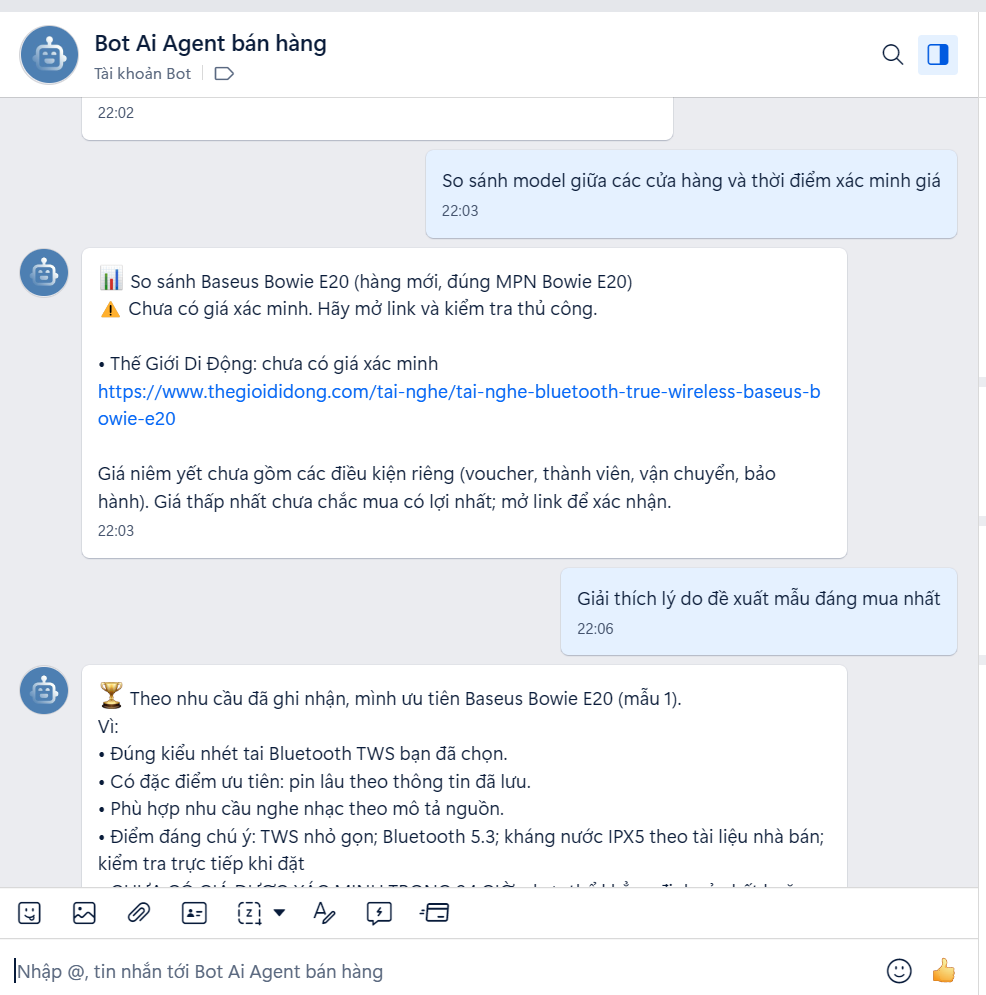
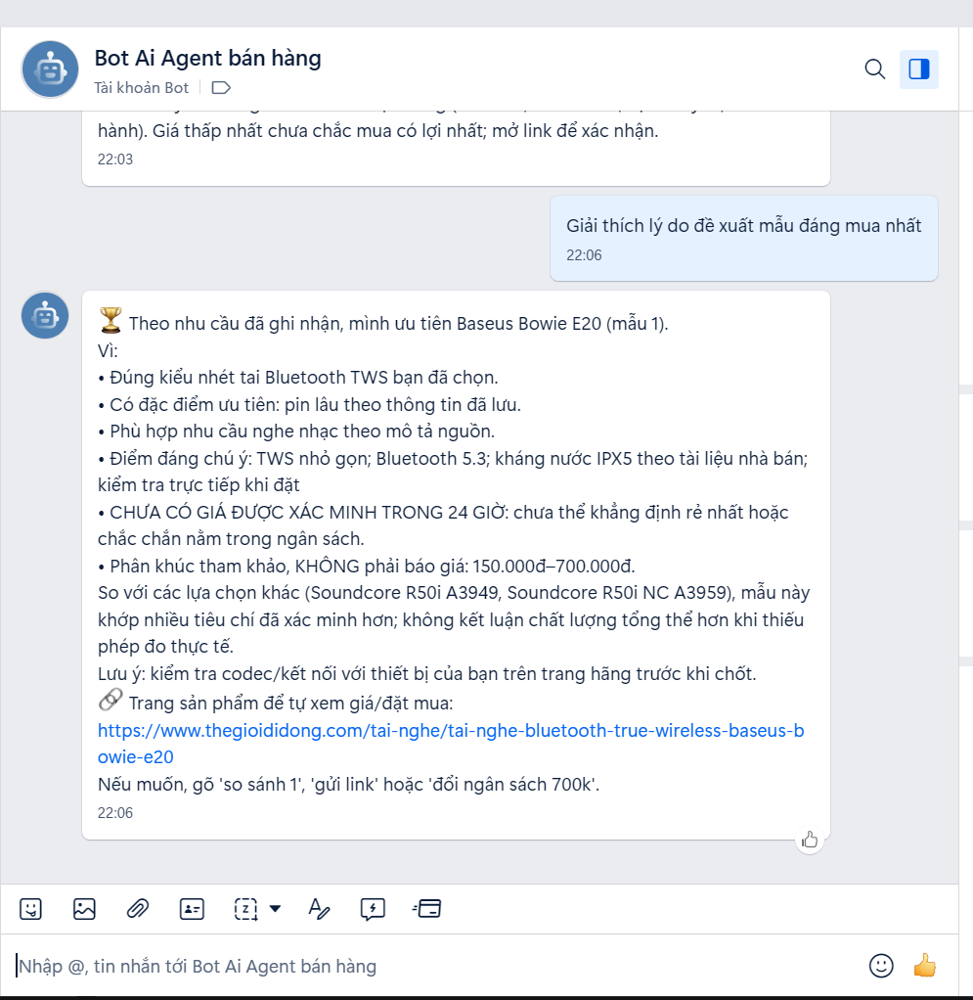

# Zalo AI Shopping Agent

**Trợ lý tư vấn mua sắm trên Zalo sử dụng Gemini Function Calling, LangGraph, RAG và dữ liệu sản phẩm có nguồn.**

[Kiến trúc](#-kiến-trúc) · [Tính năng](#-tính-năng) · [Demo](#-ảnh-demo) · [Cài đặt](#-cài-đặt-và-chạy-local) · [AI Tools](#-gemini--langgraph-tools) · [Đánh giá](#-kiểm-thử-và-đánh-giá) · [Giới hạn](#-bảo-mật-và-phạm-vi)

## 🎯 Bài toán

Khách hàng thường biết ngân sách và mục đích sử dụng nhưng chưa biết chọn model nào. Agent hỗ trợ hỏi rõ nhu cầu, tìm sản phẩm phù hợp trong dữ liệu đã nạp, so sánh thông tin từ nhiều cửa hàng và dẫn đường tới trang sản phẩm.

**Kịch bản ví dụ**

> **Khách:** Tui muốn mua tai nghe Bluetooth khoảng 700k, dùng Android, nghe nhạc bass tốt và ưu tiên chống ồn.  
> **Bot:** Ghi nhận ngân sách, kiểu tai nghe, thiết bị và ưu tiên; hỏi bổ sung nếu cần.  
> **Khách:** Gợi ý 3 mẫu phù hợp nhất.  
> **Bot:** Đề xuất những mẫu có dữ liệu thông số, kèm ưu/nhược điểm và link nguồn.  
> **Khách:** Mẫu nào đáng mua nhất? So sánh giá ở các cửa hàng nhé.  
> **Bot:** Giải thích theo nhu cầu và giá **đã xác minh**; nếu chưa có dữ liệu giá hợp lệ, thông báo rõ và chỉ cung cấp link tham khảo.

Đây là **luồng nghiệp vụ mục tiêu**, không phải ảnh hoặc cam kết về giá thời gian thực.

## ✨ Tính năng

| Nhóm chức năng | Mô tả |
|---|---|
| Tư vấn mua sắm nhiều lượt | Hỏi ngân sách, loại sản phẩm, mục đích, ưu tiên (ANC, bass, mic…), thiết bị sử dụng; ghi nhớ theo phiên chat |
| Gợi ý & giải thích | Tạo shortlist từ thông số sản phẩm có nguồn; giải thích mẫu đáng mua theo nhu cầu |
| Gemini Tool Calling | Gemini đưa ra `functionCall` để chọn công cụ đọc dữ liệu; LangGraph `ToolNode` thực thi |
| So sánh giá nhiều nơi | Ghép **đúng model/MPN, phiên bản, tình trạng**, lưu link nhà bán và giá quan sát được theo thời điểm |
| RAG chính sách | Tra cứu tài liệu bảo hành, giao hàng, đổi trả đã duyệt, kèm nguồn tham chiếu |
| Đơn hàng demo | Lệnh tạo đơn nháp/xác nhận/hủy riêng với kiểm tra nghiệp vụ; **không thanh toán tự động** |
| Thu thập dữ liệu có kiểm soát | Chỉ xử lý URL/domain có quyền truy cập phù hợp, tôn trọng robots.txt, không vượt chặn |
| Observability | Lưu `traces`, `tool-traces`, ý định xử lý, độ trễ và nguồn bằng chứng |

## 🧱 Kiến trúc



**Nguyên tắc:** AI không được quyền thực thi SQL tùy ý, không tự tạo/xác nhận đơn hàng. Kết quả về giá, hàng tồn và chính sách phải xuất phát từ dữ liệu nghiệp vụ hoặc nguồn đã được kiểm tra. Khi Gemini lỗi, hệ thống có đường fallback; cần kiểm tra trace để biết đường xử lý thực tế.

### Công nghệ

| Thành phần | Công nghệ |
|---|---|
| Kênh chat | Zalo Bot API chính thức, `getUpdates` Polling |
| AI / LLM | Google Gemini API (REST qua `httpx`) |
| Agent orchestration | LangGraph `StateGraph`, `ToolNode`, LangChain tools |
| RAG | Chunking, keyword retrieval hoặc Gemini embeddings (tùy cấu hình) |
| Backend | Python 3.12, FastAPI, SQLAlchemy, Pydantic |
| Database | SQLite local; PostgreSQL là phương án tùy chọn |
| Dữ liệu HTML | Beautiful Soup, JSON-LD; import CSV / watchlist |
| Testing | Pytest; unit tests offline và integration tests có mô phỏng API |
| Triển khai | Windows/local on-demand; Docker/Azure chỉ là tùy chọn |

## 🧰 Gemini + LangGraph Tools

Sáu công cụ chỉ đọc được khai báo trong `app/advanced/tool_agent.py`:

| Tool | Mục đích |
|---|---|
| `search_products` | Tìm sản phẩm và thông tin giá/tồn kho thuộc catalog của shop |
| `recommend_products` | Tư vấn theo ngân sách, nhu cầu và thông tin phiên chat |
| `compare_prices` | Đối chiếu cùng model giữa nhiều nhà bán, trả link và giá có trạng thái xác minh |
| `retrieve_policy` | Tìm FAQ/chính sách đã duyệt qua RAG |
| `get_product_specs` | Lấy thông số có căn cứ theo SKU hoặc mã model |
| `get_shopping_preferences` | Đọc những yêu cầu mua hàng đã ghi nhận |

Các lệnh ghi đơn `/buy`, `/confirm`, `/cancel` **không nằm trong danh sách tool của Gemini**. `ToolNode` không đồng nghĩa với việc tất cả câu hỏi đều đi qua Tool Calling; hội thoại tư vấn đang dở và một số lệnh trực tiếp dùng logic nghiệp vụ có kiểm soát.

## 🖼️ Ảnh demo

### 1. Tư vấn nhu cầu trên Zalo



### 2. Đề xuất sản phẩm và link nguồn



### 3. So sánh giá và chọn mẫu đáng mua





## 🎬 Video Demo

**[▶ XEM VIDEO DEMO — ZALO AI SHOPPING AGENT (MP4)](assets/videos/zalo-ai-shopping-agent-demo.mp4)**

## 🚀 Cài đặt và chạy local

### Yêu cầu

- Python **3.12** và Windows PowerShell (phù hợp môi trường đã kiểm thử; Linux cũng có thể chạy với lệnh kích hoạt venv tương ứng).
- Một **Zalo Bot Token** cho chế độ live polling.
- **Gemini API key** để thử Function Calling; cần kiểm tra hạn mức và model thực tế của tài khoản.
- Không cần GPU, Ollama, Zalo OA hoặc cloud 24/7.

### 1. Tạo môi trường

```powershell
# Chạy tại thư mục gốc repository
py -3.12 -m venv .venv
.\.venv\Scripts\Activate.ps1
python -m pip install -r requirements.txt
python -m pip install -r requirements-agent-v5.txt
python -m pip install -r requirements-dev.txt
Copy-Item .env.example .env
```

### 2. Cấu hình `.env`

Cập nhật các dòng cần thiết trong `.env` (KHÔNG commit file này):

```dotenv
DATABASE_URL=sqlite:///./data/app.db
BOT_MODE=live
BOT_TOKEN=YOUR_ZALO_BOT_TOKEN
LLM_PROVIDER=gemini
GEMINI_API_KEY=YOUR_GEMINI_API_KEY
GEMINI_MODEL=YOUR_ACCESSIBLE_MODEL
RAG_BACKEND=keyword
CRAWL_ALLOWED_HOSTS=
```

`RAG_BACKEND=keyword` dùng được khi không cần embedding; chuyển sang `gemini` nếu đã chuẩn bị dữ liệu và muốn chạy semantic retrieval. `CRAWL_ALLOWED_HOSTS` để trống nếu chưa có quyền crawl nguồn nào. Token và khóa API bên trên chỉ là **placeholder**.

### 3. Chuẩn bị database / dữ liệu mẫu

```powershell
python -m app.cli init-db
python -m app.cli seed-demo
python -m app.cli seed-shopping
python -m app.cli shopping-status
```

`seed-demo` dùng cho catalog/FAQ demo; `seed-shopping` nạp thông số và link theo dõi. **Không phải lệnh lấy giá live.** Chỉ dùng `seed-*` khi bạn đang dựng môi trường demo mới hoặc thực sự cần dữ liệu mẫu.

### 4. Chạy bot

```powershell
python -m scripts.zalo_setup me
python -m app.poll
```

Mở Zalo, nhắn `/tuvan`, hoặc hỏi tự nhiên như `Mình muốn mua tai nghe dưới 700k`. Dừng bot bằng **Ctrl+C**. Polling local cần không có webhook hoạt động và không chạy hai polling process cùng lúc.

## 💬 Các câu lệnh demo

| Tin nhắn/lệnh | Mục đích |
|---|---|
| `/tuvan` | Bắt đầu hoặc khởi động lại tư vấn mua sắm |
| `Mình cần tai nghe Bluetooth tầm 700k, ưu tiên ANC` | Tư vấn tự nhiên |
| `Trong các mẫu đó mẫu nào đáng mua nhất?` | Kiểm tra ghi nhớ và giải thích lựa chọn |
| `/compare SONY-WHCH520-NEW` | So sánh giá theo model chuẩn hóa |
| `Bảo hành và đổi trả như thế nào?` | Tra RAG chính sách |
| `/products` | Xem catalog của shop |
| `/buy TAI-001 1` | Tạo đơn nháp trong hệ thống demo |
| `/orders` | Kiểm tra đơn hàng của phiên chat |

**Lưu ý:** URL trong watchlist không bảo đảm có giá thực tế. Không khẳng định cửa hàng rẻ nhất khi thiếu các quan sát giá đã xác minh, đồng thời không giả định rằng mã hàng/giá luôn còn hiệu lực.

## 📦 Dữ liệu và so sánh giá

- `examples/curated_headphone_specs_v4.csv`: thông số và nhu cầu phù hợp của các model tham khảo.
- `examples/real_headphone_watchlist_v4.csv`: danh sách model → nhà bán → URL, `crawl_enabled=false` mặc định.
- `data/crawl_sources.txt`: URL trang được phép thu thập cho kho dữ liệu RAG, **khác** bảng giá nhà bán.
- `data/app.db`: SQLite local, không nằm trong repository công khai.

Các lệnh hữu ích:

```powershell
python -m app.cli shopping-status
python -m app.cli compare SONY-WHCH520-NEW
python -m app.cli compare-import examples/real_headphone_watchlist_v4.csv
python -m app.cli observations
```

Khi **đã xác minh quyền truy cập và việc thu thập**, bạn có thể dùng các lệnh có `--ack-permission` theo [tài liệu v4](docs/HUONG_DAN_V4_TU_VAN_MUA_HANG.md). Nếu website không cho crawler truy cập, dùng nguồn dữ liệu được cấp phép hoặc nhập giá kiểm duyệt thủ công qua `compare-reviewed`. Không vượt CAPTCHA/403, không giả lập giá và không ghi đè giá/tồn kho chính thức của shop bằng HTML chưa xác minh.

## 🧪 Kiểm thử và đánh giá

Để tránh gọi Gemini thật trong unit tests, mở **một Terminal riêng** và chạy:

```powershell
$env:LLM_PROVIDER = "none"
$env:GEMINI_API_KEY = ""
$env:TEMP = (Join-Path (Get-Location).Path '.test_tmp')
$env:TMP = $env:TEMP
New-Item -ItemType Directory -Force $env:TEMP | Out-Null
.\.venv\Scripts\python.exe -m pytest -q tests --basetemp '.\.test_tmp\pytest-run'
```

**Mốc đã ghi nhận:** 71 bài test offline đạt trên môi trường Windows trong quá trình xây dựng; sau khi áp dụng các hotfix gần nhất, cần chạy lại và cập nhật ảnh/test count thực tế trước khi public GitHub. Không dùng unit-test pass để khẳng định Gemini API và E2E Agent đã hoạt động liên tục.

Để kiểm thử live, **mở Terminal mới** dùng `.env` thật:

```powershell
python -m app.cli agent-status
python -m app.cli traces
python -m app.cli tool-traces
```

Ý nghĩa:

- `agent-status` cho biết điều kiện chạy Tool Agent đã được cấu hình, **không xác minh API live**.
- `tool-traces` có `tool=... status=ok` chứng minh code đã ghi nhận một lần thực thi tool.
- Chỉ khi `traces` ghi `engine=gemini_langgraph_tools` cho một lượt hỏi thật, ta mới có bằng chứng rằng lượt đó hoàn tất qua đường Gemini + ToolNode.

### Trạng thái tích hợp thực tế

Trong giai đoạn debug v5, đã xác nhận Gemini chọn `search_products`, ToolNode có bản ghi `status=ok`, nhưng có lượt **`ReadTimeout`** khiến engine chuyển về `langgraph` fallback. Đã chuẩn bị hotfix phục hồi kết quả tool; **chưa coi đây là xác nhận end-to-end live thành công** cho tới khi kiểm tra trace trên máy chạy cuối cùng.

## 🗂️ Cấu trúc repository

```text
zalo-ai-agent-free/
├── app/
│   ├── advanced/
│   │   ├── flow.py                  # Điều phối và fallback
│   │   └── tool_agent.py            # Gemini planner + LangGraph ToolNode
│   ├── buyer_advisor.py             # Tư vấn nhiều lượt
│   ├── price_compare.py             # Ghép model, so sánh giá
│   ├── rag.py                       # Truy xuất tài liệu
│   ├── commerce.py                  # Lệnh đơn hàng có kiểm soát
│   ├── poll.py                      # Zalo getUpdates
│   └── ...
├── scripts/                         # CLI, Zalo setup, crawler
├── examples/                        # CSV mẫu & watchlist
├── data/                            # Chỉ các tệp nguồn công khai; không commit app.db
├── tests/                           # Unit & integration tests
├── docs/                            # Hướng dẫn và kiến trúc
├── assets/screenshots/              # Ảnh demo README
├── .github/workflows/              # CI; workflow crawl tự động là tùy chọn
├── .env.example
├── .gitignore
├── requirements*.txt
├── pytest.ini
└── README.md
```

## 🔐 Bảo mật và phạm vi

- Không commit `.env`, `data/*.db`, `data/*-wal`, `data/*-shm`, `backups/`, `.venv/` hoặc log có token.
- Zalo Bot Token có thể nằm trong URL HTTP; chỉ đăng ảnh Terminal **đã kiểm tra và che khóa bí mật**.
- Đây là **trợ lý giới thiệu sản phẩm và tạo đơn demo**, không thanh toán, không truy cập tài khoản khách hàng ở bên thứ ba.
- Dữ liệu giá từ nhà bán có thể thiếu hoặc đã cũ. Giá chỉ được xem là đã xác minh khi có nguồn, đúng phiên bản và thời điểm kiểm tra.
- Gemini, website và Zalo có thể bị timeout, giới hạn truy cập hoặc thay đổi API. Fallback không đồng nghĩa với Tool Calling thành công.

**Mục đích:** Nghiên cứu, học tập, demo kỹ thuật AI Engineering và portfolio. Dữ liệu/link tham khảo thuộc các nhà cung cấp tương ứng; dự án không đại diện chính thức cho các nhà bán lẻ được nhắc đến.
