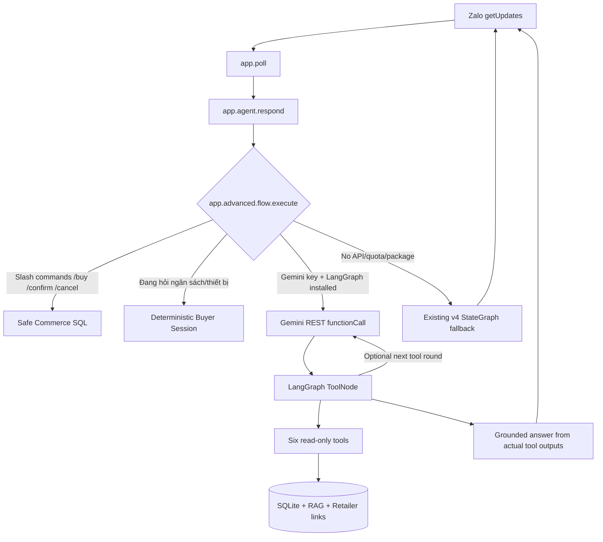

# NÂNG CẤP V5 — Gemini chọn tools thật + LangGraph ToolNode

**Cập nhật:** 13/10/2026. **Đối tượng:** thư mục Windows hiện có `D:\Code\project_AI\zalo-ai-agent-free` đang chạy Zalo bằng `python -m app.poll`.

> **Không tạo lại bot, không đổi token, không cài lại project, không chuyển database hoặc Azure.** Patch chỉ thêm/sửa các file Python cần thiết; giữ nguyên `.env`, `data/app.db`, `.venv`, `app/poll.py`, `app/zalo.py`, Dockerfile và `docker-compose.yml`.

## 1. Chức năng mới: AI thực sự chọn công cụ



Model có quyền gọi **sáu** tool. Các công cụ được thực thi **tuần tự bằng LangGraph ToolNode** để không truy cập đồng thời cùng một SQLAlchemy Session SQLite:

| Tool | File | Vai trò |
|---|---|---|
| `search_products(query,max_price_vnd)` | `app/advanced/tool_agent.py` | Tìm giá chính thức & tồn kho trong catalog bán hàng |
| `recommend_products(request)` | `.../tool_agent.py` → `buyer_advisor.advise` | Hỏi nhu cầu, tạo shortlist và chọn mẫu đáng mua |
| `compare_prices(model_or_request)` | `.../tool_agent.py` → `price_compare` | So sánh cùng mã model, dẫn link TGDD/CellphoneS/nguồn khác |
| `retrieve_policy(query)` | `.../tool_agent.py` → `rag.search` | RAG tài liệu đã duyệt, trích dẫn chính sách |
| `get_product_specs(model_or_sku)` | `.../tool_agent.py` | Tra SKU/model và thông số có căn cứ |
| `get_shopping_preferences()` | `.../tool_agent.py` | Đọc ngân sách, kiểu tai nghe, ưu tiên đã lưu |

**Đơn hàng được xử lý thế nào?** Gemini KHÔNG có các công cụ `create_order`, `confirm_order`, `execute_sql`. Mọi thao tác ghi dữ liệu chỉ được thực thi bởi parser `/buy SKU QTY` và `/confirm MÃ` đã có sẵn ở `app/commerce.py`, cùng kiểm tra người dùng và tồn kho. Điều này cố ý giới hạn quyền của AI để an toàn khi demo.

Không có giá thời gian thực? Bot hiện link sản phẩm đã xác minh và ghi **"chưa xác minh"** thay vì đoán giá. Nguồn đã bị robots.txt từ chối không được crawler vượt chặn.

## 2. Cập nhật trực tiếp, chỉ cần một lần

**Dừng Zalo Polling bằng `Ctrl + C`** trong terminal VS Code; Docker nếu đang chạy process tương tự cũng cần dừng để tránh hai bot đồng thời.

1. Giải nén `Zalo_AI_Agent_v5_GEMINI_TOOL_CALLING_PATCH.zip` vào thư mục tạm, ví dụ `D:\Downloads\zalo-v5-patch`.
2. Mở PowerShell ngay tại thư mục tạm chứa `apply_agent_v5.ps1`.
3. Chạy:

```powershell
Set-ExecutionPolicy -Scope Process -ExecutionPolicy Bypass
.\apply_agent_v5.ps1 -Target 'D:\Code\project_AI\zalo-ai-agent-free'
```

Script kiểm tra source v4, backup những file chuẩn bị ghi đè và backup `data/app.db` nếu có. **Không xóa DB cũ.** Mặc định script cài duy nhất dependency AI chưa có trong `.venv` (`langgraph`, `langchain-core`) thông qua `requirements-agent-v5.txt`. Nếu máy đã cài rồi, pip sẽ báo `Requirement already satisfied`. Dùng `-SkipInstall` nếu muốn tự cài sau.

Nếu không muốn chạy script, copy riêng những file trong `payload/` vào dự án, rồi chạy:

```powershell
cd D:\Code\project_AI\zalo-ai-agent-free
.\.venv\Scripts\Activate.ps1
python -m pip install -r requirements-agent-v5.txt
python -m app.cli init-db
```

**Không chạy `seed-demo` hay `seed-shopping` nếu dữ liệu đã có**, vì không bắt buộc. `init-db` chỉ tạo thêm bảng `agent_tool_traces` để xem model đã gọi công cụ nào.

## 3. Sử dụng GEMINI API đang có

Mở `.env` **hiện tại**, kiểm tra:

```dotenv
BOT_MODE=live
BOT_TOKEN=TOKEN_ZALO_DA_TAO_TRUOC_DAY
DATABASE_URL=sqlite:///./data/app.db
LLM_PROVIDER=gemini
GEMINI_API_KEY=API_KEY_GEMINI_CUA_BAN
GEMINI_MODEL=gemini-2.5-flash-lite
RAG_BACKEND=gemini
```

Chỉ sửa các dòng thực sự thiếu/sai, **không ghi đè Bot Token**. `GEMINI_MODEL=gemini-2.5-flash-lite` được tài liệu pricing Google công bố có Free Tier tại thời điểm này; hãy kiểm tra model nào được cấp cho project thực tế. Không thêm billing trả phí nếu muốn 0đ. Khi API lỗi/quota hết, bot quay về tuyến Python/RAG cũ.

Có thể để `RAG_BACKEND=keyword` nếu không muốn gửi tài liệu lên embedding API hoặc tiết kiệm quota. Không cần Ollama/GPU/PyTorch/Colab.

> **Riêng tư**: Free Tier của Gemini có điều khoản sử dụng dữ liệu để cải thiện dịch vụ; chỉ nên gửi mô tả sản phẩm/FAQ công khai và câu hỏi đã lọc thông tin nhạy cảm. Không gửi đơn hàng thật, OTP, địa chỉ, số điện thoại, API token vào Gemini.

## 4. Kiểm tra đã bật ToolNode hay chưa

```powershell
cd D:\Code\project_AI\zalo-ai-agent-free
.\.venv\Scripts\Activate.ps1
python -m app.cli agent-status
python -m pytest -q
```

Mong đợi: `tool_agent_ready: True` (có thể chỉ là cấu hình đúng; chưa chứng minh API đã gọi thành công). Tool agent chỉ kích hoạt khi có Gemini API key, provider gemini và hai thư viện LangGraph/langchain-core.

## 5. Chạy trên Zalo và quan sát model gọi tools

```powershell
python -m app.poll
```

Trên Zalo, gửi riêng từng tin và đợi bot phản hồi:

1. `Tui muốn mua tai nghe Bluetooth nhét tai tầm 700k, nghe nhạc, dùng Android, ưu tiên chống ồn.`
2. `Gợi ý 3 mẫu phù hợp và gửi link mua hàng.`
3. `Trong 3 mẫu đó mẫu nào đáng mua nhất? Vì sao?`
4. `So sánh giá cùng mã Sony WH-CH520 ở TGDD và CellphoneS.`
5. `Bảo hành sản phẩm như thế nào?`

Các câu `/buy TAI-001 1`, `/confirm OD...`, `/orders`, `/compare MÃ` vẫn chạy bởi code nghiệp vụ cũ. Những câu trả lời dạng đánh giá nhiều lượt phụ thuộc vào dữ liệu bạn đã nạp trong `seed-shopping`, các link nguồn và giá được xác minh; bot không được tự bịa.

**Mở terminal thứ hai**:

```powershell
python -m app.cli traces
python -m app.cli tool-traces
```

Khi Gemini ToolNode thật sự thực thi tools:

```text
route=advisor_best_choice engine=gemini_langgraph_tools provider=gemini
1: tool=recommend_products intent=advisor_best_choice status=ok
2: tool=get_shopping_preferences intent=preferences status=ok
```

Nếu chỉ có `engine=advisor_state` thì đó là bước tiếp tục form cố định (ví dụ trả lời `500k`, `Android`) — hoàn toàn bình thường. Nếu `engine=langgraph` thì đang dùng **StateGraph Router cũ** do API không chọn tool hoặc lỗi/quota; kiểm tra model, key, hạn mức và Internet. `agent-status` không chứng minh đã gọi API thành công.

## 6. Kiểm thử & tiêu chí hoàn thành

- `python -m pytest -q`: toàn bộ test cũ + tests mới; test runtime LangGraph sẽ **skip** nếu không có thư viện. Sau khi cài, test phải chạy thật.
- Lượt truy vấn sản phẩm tự do có `engine=gemini_langgraph_tools` và `tool=search_products`.
- Lượt tư vấn nhiều bước có `tool=recommend_products`; kết quả cuối có link sản phẩm và nêu rõ nguồn giá.
- Lượt hỏi chính sách có `tool=retrieve_policy` và citations đã duyệt.
- Giá chưa xác minh không được hiển thị là giá tốt nhất.
- Câu `/confirm` không tạo thêm đơn khi trùng hoặc không phải người sở hữu.

## 7. Xử lý lỗi thường gặp

| Triệu chứng | Cách kiểm tra |
|---|---|
| `tool_agent_ready=False` | `pip install -r requirements-agent-v5.txt`; kiểm tra `.env` provider/key |
| `engine=langgraph` nhưng không thấy `tool-traces` | Có thể Gemini không gọi tool hoặc lỗi; model/key/quota/API REST |
| HTTP 429 | Gemini Free Tier hết quota; chờ reset, tránh gọi thử liên tục, bot fallback |
| Không gợi ý đủ 3 mẫu | `python -m app.cli shopping-status`, `python -m app.cli seed-shopping` nếu thiếu |
| Không có giá thật | `python -m app.cli compare ...`; phải nạp giá đã xác minh, link không phải báo giá |
| `ModuleNotFoundError: app` | `cd D:\Code\project_AI\zalo-ai-agent-free` và kích hoạt đúng `.venv` |
| Zalo không nhắn lại | Dừng webhook, dùng polling một tiến trình; kiểm tra log đã che Bot Token |
| Trả lời chậm | Gemini tối đa 2 vòng gọi tool mỗi tin; rút ngắn câu hỏi hoặc để provider none |

**Kết luận**: v5 thay đổi thật phần chọn tool bằng Gemini. Nó vẫn là MVP demo (không có giao hàng/thanh toán) và không bảo đảm mọi nhà bán đều cho crawler truy cập hoặc có giá xác minh.
